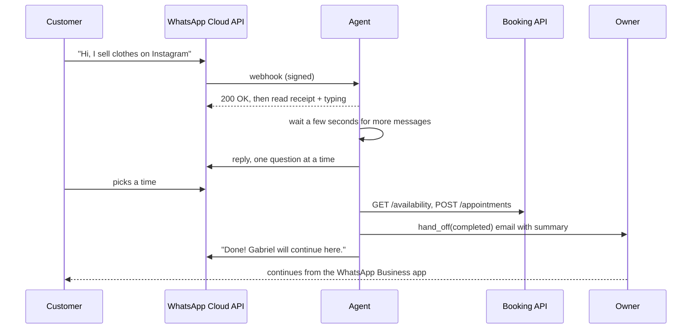

# WhatsApp AI Agent

[](https://github.com/amaringonz/whatsapp-ai-agent/actions/workflows/ci.yml)
[](LICENSE)

A business-specific AI agent for WhatsApp. It answers customers like a careful team member, qualifies leads, books appointments and **hands the conversation to a human only when the job is done or something needs a person**.

Built with TypeScript, [Hono](https://hono.dev) and the [WhatsApp Cloud API](https://developers.facebook.com/docs/whatsapp/cloud-api). It runs on [Claude](https://docs.claude.com) or [OpenAI](https://developers.openai.com), deploys to Vercel and keeps conversations in Upstash Redis.

```
Customer ──▶ WhatsApp ──▶ /webhook ──▶ Agent (LLM + tools) ──▶ WhatsApp reply
                                         │
                                         ├─ get_availability / book_appointment ──▶ your booking API
                                         └─ hand_off ──▶ email to the owner, agent goes quiet
```

## What it does

- **Answers in the customer's language**, in short WhatsApp-style messages, using only what the business wrote in its config. It never invents prices, dates or promises.
- **Works with Claude or OpenAI.** One OpenAI key is enough for everything: conversation, photos, PDFs and voice notes.
- **Reads photos, PDFs and voice notes.** Photos and PDFs go to the model as images and documents; voice notes are transcribed with any OpenAI-compatible speech-to-text API (OpenAI, Groq and others). Attachments are only sent on the turn they arrive, so the saved history stays small. Locations and shared contacts arrive as text; videos and unsupported files get a polite request for another format.
- **Waits for the customer to finish typing.** Several quick messages are answered together, with read receipts and a typing indicator.
- **Books appointments** through a small HTTP contract, so it works with any calendar or backend.
- **Hands off with context.** When the goal is reached or a case is urgent, the owner gets an email with a summary, the lead details and the transcript, and the agent stops answering in that chat.
- **Steps aside when a human writes.** With [WhatsApp Coexistence](https://developers.facebook.com/docs/whatsapp/embedded-signup/onboarding-business-app-users), messages sent from the WhatsApp Business app pause the agent for that chat. Replying `/bot` from the app hands it back.
- **Stays in scope.** It only talks about the business, which keeps it within WhatsApp's 2026 policy for AI on the Business Platform: business-specific assistants are allowed, general-purpose chatbots are not.
- **Is honest about being an assistant** when someone asks.

## How a conversation flows



## Project layout

```
src/
  routes.ts            Hono routes: webhook verification, signed webhook, health
  index.ts             Vercel entry (uses waitUntil to answer Meta right away)
  server.ts            Local Node server
  agent/
    service.ts         Debounce, locking, pauses, handoff orchestration
    run.ts             Tool-use loop and history trimming
    prompt.ts          System prompt built from the business config
    tools.ts           hand_off, get_availability, book_appointment
    anthropic.ts       Claude adapter (prompt caching on the system prompt)
    openai.ts          OpenAI Chat Completions adapter
  media/               Photo, PDF and text-file reading; voice note transcription
  whatsapp/            Signature check, webhook parsing, Cloud API client and media download
  store/               Upstash Redis and in-memory conversation stores
  booking/             HTTP booking provider
  notify/              Resend email and console notifiers
  config/              Zod schemas for the environment and the business
examples/              A complete example business
test/                  Vitest suite with a scripted model
```

## Quick start

```bash
npm install
cp .env.example .env            # fill in the values you have
npm test                        # no keys or network needed

# Talk to the agent in your terminal with the example business
OPENAI_API_KEY=... npm run chat -- examples/business.example.json   # or ANTHROPIC_API_KEY
```

In the terminal chat, `/owner <text>` simulates you writing from the WhatsApp Business app and `/bot` hands the chat back to the agent.

## Describe your business

Everything the agent knows comes from one JSON file, validated with Zod. Keep real configs out of git: set `BUSINESS_CONFIG` (the JSON itself) in your hosting provider, or point `BUSINESS_CONFIG_PATH` to a file in the ignored `config/` folder.

```jsonc
{
  "business": { "name": "...", "description": "...", "hours": "...", "language": "es", "timezone": "America/Costa_Rica" },
  "assistant": { "name": "...", "owner": "...", "tone": "...", "disclosure": "..." },
  "goal": "What a successful conversation ends with",
  "knowledge": [{ "title": "Services", "content": "..." }],
  "rules": ["Never give prices", "..."],
  "handoff": {
    "completed": "When the goal counts as done",
    "urgent": ["Situations that need a person right away"]
  },
  "booking": {
    "enabled": true,
    "description": "...",
    "fields": [{ "name": "budget", "description": "...", "options": [{ "value": "low", "label": "Under $500" }] }]
  }
}
```

See [`examples/business.example.json`](examples/business.example.json) for a full dental clinic.

## Booking API contract

Booking is optional. When `BOOKING_API_URL` and `BOOKING_API_TOKEN` are set, the agent calls two endpoints with `Authorization: Bearer <token>`:

| Method | Path            | Response                                                                 |
| ------ | --------------- | ------------------------------------------------------------------------ |
| GET    | `/availability` | `{ "days": [{ "date": "2026-12-02", "label": "Wed Dec 2", "slots": [{ "time": "09:00", "label": "9:00 a.m." }] }] }` |
| POST   | `/appointments` | `201 { "id", "summary" }`, `409` if the slot was taken, `422` if data is invalid |

The POST body is `{ name, phone, date, time, fields, source: "whatsapp" }`, where `fields` holds the booking fields from your config.

## Environment

| Variable | Required | Purpose |
| --- | --- | --- |
| `WHATSAPP_TOKEN`, `WHATSAPP_PHONE_NUMBER_ID` | yes | Cloud API access |
| `WHATSAPP_APP_SECRET` | yes | Verifies `X-Hub-Signature-256` on every webhook |
| `WHATSAPP_VERIFY_TOKEN` | yes | Any string; repeat it when you register the webhook |
| `OPENAI_API_KEY` or `ANTHROPIC_API_KEY` | yes | The model provider. With only an OpenAI key, OpenAI also transcribes voice notes |
| `AI_PROVIDER` | no | `openai` or `anthropic`. Defaults to Anthropic when its key is set, otherwise OpenAI |
| `OPENAI_MODEL`, `OPENAI_BASE_URL` | no | Defaults to `gpt-6.2-sol` on `https://api.openai.com/v1` |
| `ANTHROPIC_MODEL` | no | Defaults to `claude-sonnet-5-5` |
| `BUSINESS_CONFIG` or `BUSINESS_CONFIG_PATH` | yes | The business description |
| `UPSTASH_REDIS_REST_URL` / `_TOKEN` (or `KV_REST_API_*`) | production | Conversation memory; falls back to memory |
| `BOOKING_API_URL`, `BOOKING_API_TOKEN` | no | Enables booking tools |
| `TRANSCRIPTION_API_KEY` | no | Enables voice notes. Uses `OPENAI_API_KEY` when transcribing with OpenAI. Without a key the agent asks the customer to write instead |
| `TRANSCRIPTION_BASE_URL`, `TRANSCRIPTION_MODEL` | no | Any OpenAI-compatible `/audio/transcriptions` API. Defaults to OpenAI `gpt-4o-mini-transcribe`; for Groq use `https://api.groq.com/openai/v1` and `whisper-large-v3-turbo` |
| `RESEND_API_KEY`, `NOTIFY_EMAIL_FROM`, `NOTIFY_EMAIL_TO` | no | Handoff emails; falls back to logs |
| `DEBOUNCE_MS` | no | Wait for more messages, default `4000` |
| `HUMAN_PAUSE_HOURS` | no | How long the agent stays quiet after a handoff or a human reply, default `24` |
| `HISTORY_LIMIT` | no | Messages kept per chat, default `40` |

## Deploy

1. Import the repository in Vercel. It detects Hono and serves `src/index.ts`.
2. Add an Upstash Redis store from Vercel Storage and the variables above.
3. In your Meta app, set the callback URL to `https://<your-app>/webhook` with your verify token and subscribe to `messages` and `smb_message_echoes`.
4. To keep using the WhatsApp Business app on the same number, onboard it with **Coexistence**. Meta asks for some days of real activity in the app before the number qualifies.

## Testing

`npm test` runs the suite with a scripted model, so it needs no keys or network. It covers signature checks, webhook parsing, media reading and transcription, both model adapters, prompt building, history trimming, debouncing, booking, handoff, human takeover, pause expiry and tool failures. `npm run typecheck` runs the TypeScript compiler in strict mode.

## License

[MIT](LICENSE) © 2026 Alejandro Marín González
